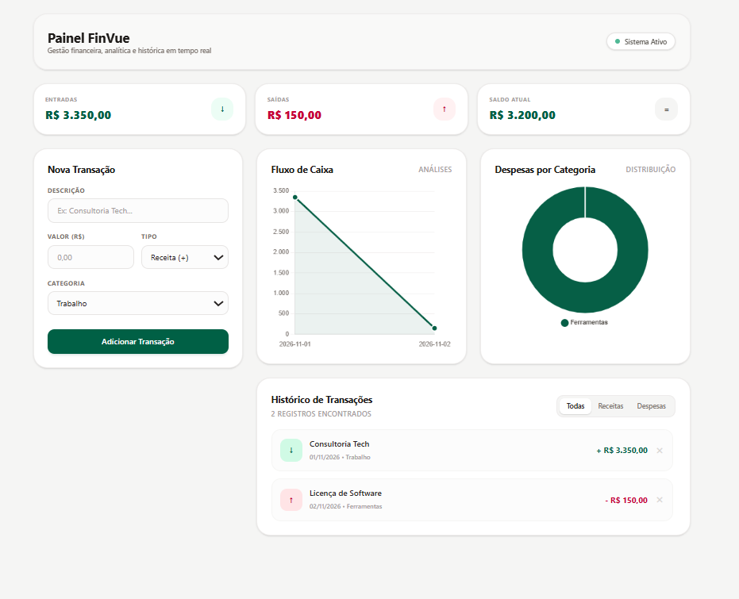

# 📈 FinVue — Dashboard Financeiro em Vue 3 & TypeScript

FinVue é uma aplicação web moderna de gestão e análise financeira pessoal, desenvolvida para demonstrar boas práticas de arquitetura frontend, reatividade com **Pinia**, gestão de rotas com **Vue Router**, visualização de dados com **Chart.js** e design responsivo avançado com **Tailwind CSS**.


---

## 🚀 Tecnologias Utilizadas

- **Framework:** Vue 3 (Composition API + `script setup`)
- **Roteamento:** Vue 3 Router (com Lazy-loading de views)
- **Linguagem:** TypeScript
- **Gerenciamento de Estado:** Pinia (com persistência em `LocalStorage`)
- **Estilização:** Tailwind CSS (Paleta personalizada *Stone* & *Emerald*)
- **Visualização de Dados:** Chart.js & Vue-ChartJS
- **Build Tool:** Vite

---

## ✨ Funcionalidades

- 💰 **Cartões de KPI:** Exibição dinâmica de Entradas, Saídas e Saldo Líquido atualizados em tempo real.
- 📉 **Fluxo de Caixa (Line Chart):** Evolução histórica das movimentações financeiras.
- 🍕 **Distribuição por Categoria (Doughnut Chart):** Análise proporcional dos gastos por categoria (Trabalho, Alimentação, Lazer, etc.).
- ⚡ **Filtros Dinâmicos:** Alternância rápida entre visualizar todas as transações, apenas receitas ou apenas despesas.
- 📝 **Registro com Categorias:** Formulário interativo para adicionar transações classificadas.
- 💾 **Persistência de Dados:** Integração com `LocalStorage` para retenção dos dados entre sessões.
- 🎨 **Design UI/UX Premium:** Interface corporativa limpa em tons de cinza suave (*Stone*) e verde musgo (*Emerald*).

---

## 📸 Pré-visualização

<div align="center">
  
</div>

---

## 📂 Estrutura do Projeto

```text
src/
├── assets/         # Recursos estáticos e estilos globais
├── components/     # Componentes reutilizáveis (Formulários, Gráficos, Listas)
├── router/         # Configuração de rotas da aplicação
├── stores/         # Gestão de estado global com Pinia
├── types/          # Definições de tipagens TypeScript
├── views/          # Páginas principais (Dashboard, NotFound)
├── App.vue         # Componente raiz com o container de rotas
└── main.ts         # Ponto de entrada da aplicação
```

---

## 🛠️ Como Executar o Projeto Localmente

```bash
# Clonar o repositório
git clone https://github.com/seu-usuario/finvue.git

# Entrar no diretório do projeto
cd finvue

# Instalar as dependências
npm install

# Iniciar o servidor de desenvolvimento
npm run dev
```

---

## 📦 Build para Produção

```bash
# Compilar a aplicação para distribuição
npm run build
```

---

## 🗺️ Roadmap

- [x] Gestão de saldos e transações em tempo real
- [x] Gráficos analíticos de fluxo de caixa e categorias (Chart.js)
- [x] Persistência de dados com LocalStorage
- [x] Roteamento estruturado com Vue Router
- [ ] Suporte a múltiplos idiomas (i18n)
- [ ] Exportação de relatórios em formato CSV/PDF
- [ ] Autenticação de usuários

---

## 👤 Autor

Desenvolvido por **Gyzela Mendes Silva**
- **LinkedIn:** [https://www.linkedin.com/in/gyzela-mendes-silva/]
- **GitHub:** [https://github.com/Gyzela-Mendes]
---

## 📝 Licença

Este projeto está sob a licença [MIT](LICENSE).

